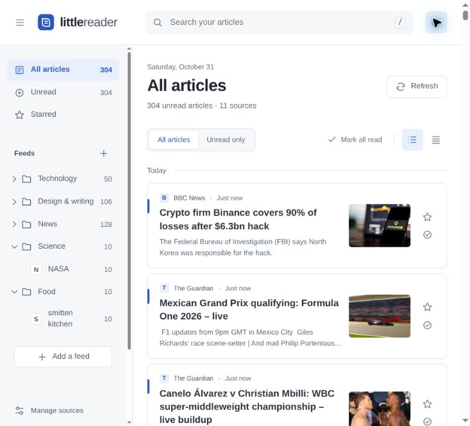
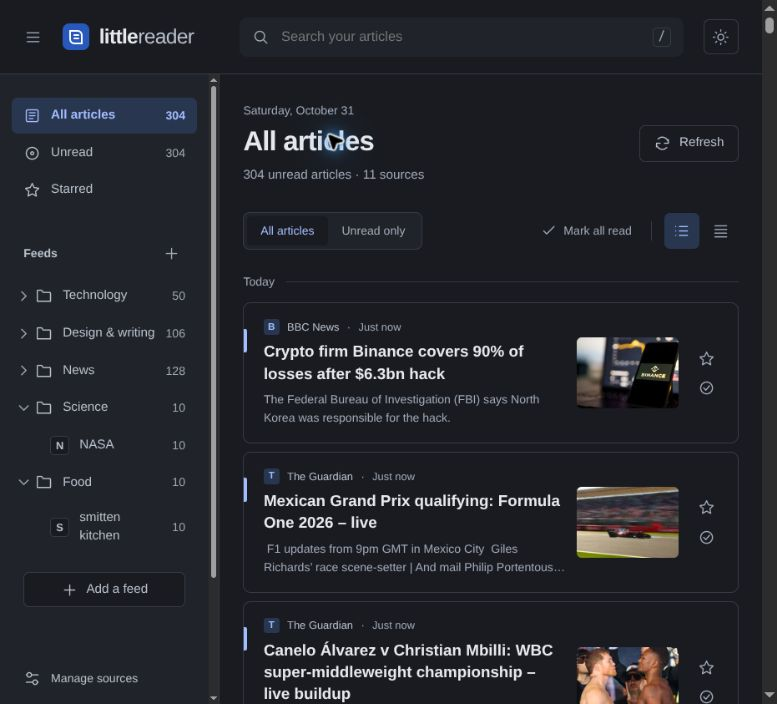

# Little Reader

Your sources. At your pace.

A small RSS reader inspired by the useful bits of the Google Reader era: subscriptions, folders, chronological articles, and a star for things worth keeping. No account, database, recommendation engine, or build step.

## Screenshots

Real RSS feeds in light and dark mode:

| Light                                                   | Dark                                                |
| ------------------------------------------------------- | --------------------------------------------------- |
|  |  |

## Run locally

Requires Node.js 22 or later.

```sh
npm install
npm run dev
```

Open http://localhost:3000. If that port is occupied:

```sh
PORT=4173 npm run dev
```

The first visit shows a labelled sample collection with fictional articles and original SVG illustrations. Adding your first real feed replaces it. You can also choose **Start fresh**.

## Starter collection

For a populated demo, choose **Import subscriptions** and select [examples/starter-feeds.opml](examples/starter-feeds.opml). It includes eight public feeds across News, Technology, Design & writing, Science and Food. Import adds to an existing collection and skips duplicate feed URLs. Articles are fetched live rather than bundled in the repository.

The starter file contains public subscriptions only. Personal newsletter feed addresses and browser storage are not included.

## What it does

- Read RSS 2.0, RSS 1.0 and Atom feeds
- Paste a direct feed URL, or a website that advertises its feed
- Create, collapse, rename and remove folders; move feeds between them
- Search downloaded article titles, sources and text
- Mark articles read/unread and star favourites
- Choose comfortable or compact rows
- Switch between light and dark mode; starts with your system preference and remembers your choice
- Open an article's feed text in a distraction-free reading view
- Load the full original article on demand, including paragraphs, images and lists; extracted content is cached in this browser
- Import/export OPML subscriptions, including a Feedly export
- Download/restore a JSON backup including articles and reading state
- Use a responsive sidebar and keyboard-accessible controls; `/` focuses search

## Deploy to Vercel

1. Push this directory to a GitHub repository.
2. Import that repository into Vercel.
3. Choose **Other** as the framework if prompted. The included `vercel.json` sets `public` as the output directory; no build command or environment variables are needed.
4. Deploy.

`api/feed.js` runs as a Node.js Vercel Function. Static HTML, CSS and JavaScript live in `public/`. The local server uses the same API handler. Vercel's Node function and project configuration references: https://vercel.com/docs/functions/runtimes/node-js and https://vercel.com/docs/project-configuration

No deployment has been created automatically. You can review the project before publishing it.

## Storage and privacy

Subscriptions, folders, articles, read status and stars are stored in **localStorage in this browser**, under `little-reader:v1`. They survive reloads, but do not sync between devices, browsers or domains. Clearing site data removes them. Use **Download backup** periodically, and restore through **Import subscriptions**. OPML contains subscriptions and folders only.

The server fetches feed addresses on your behalf and does not intentionally persist them. URLs are sent to the hosting provider as query parameters, so provider request logging may include them. Keep private newsletter feeds and exported backups private. Article images load directly from publishers; no external fonts, analytics, advertising SDKs or third-party feed proxies are used.

The deployed app has no login: visitors have their own browser-local collection. The fetch endpoint is accessible to anyone with the app address. The same protections apply to full-article requests. Private/reserved IP ranges, credentials in URLs and nonstandard ports are blocked; DNS is checked and the connection pinned to that checked address, including after redirects. Requests have time and size limits. This is intended for personal use, not as a large public feed-fetching service.

## Deliberate limits

- Refresh is manual, including when reopening the reader. No background polling.
- Feed text appears first. **Load full article** fetches the public page and uses Mozilla Readability to extract reading content. Extraction depends on the publisher’s page and may fail on blocked, paywalled or JavaScript-only sites; use **Read original** in those cases.
- Feed excerpts use plain text. Full articles preserve safe formatting and are sanitised on the server, then rebuilt from permitted elements in the browser, including when restored from a backup. Scripts, forms and embedded frames are omitted.
- Up to 300 sources, 100 entries per fetch, and 200 retained ordinary entries per source; starred entries are retained. Browser storage capacity may impose a lower practical limit. A visible warning appears if storage cannot be written.
- Imported OPML folders are flattened to the nearest parent folder. Duplicate feed addresses are skipped.
- Fetching is limited to HTTP/HTTPS on standard ports and 2 MB per response. Feeds requiring cookies, authentication, non-UTF-8 encoding or custom ports are not supported. Some publishers may block datacentre requests.
- Real-phone testing is still needed for device-specific touch and browser behaviour.

## Project structure

```text
public/           Browser app and original sample illustrations
api/feed.js       Vercel API handler
lib/feed.js       Feed fetching, discovery, parsing and URL validation
api/article.js    Full-article API handler
lib/article.js    Mozilla Readability extraction and HTML sanitisation
server.js         Small local development server
test/             Node test runner tests
vercel.json       Hosting configuration and response headers
```

```sh
npm test
npm run check
```

No personal subscriptions, credentials or browser data are stored in the repository.

## Design credit

Interface design was informed by [Unslop](https://github.com/heydamir/unslop) by Damir Sokolovsky ([@heydamir](https://x.com/heydamir)), licensed under CC BY 4.0. Its guidance informed spacing, restrained chrome, typography and the small unread indicator. The application code and sample SVG illustrations are original and licensed under MIT.
